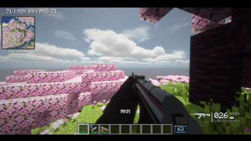
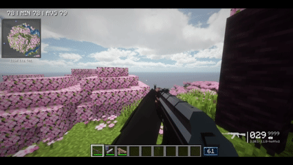

# TaCZ Ad Astra Arm Fix (Unofficial Patch)

With an Ad Astra space suit, netherite space suit or jet suit chestplate on, your first-person arms go wrong while holding a TaCZ gun. They stretch, point off into the distance and get worse as you aim, reload and run. This small companion mod draws your normal arms in first person instead, exactly as without a suit, so TaCZ guns are held properly.

The stretching happens when [playerAnimator](https://www.curseforge.com/minecraft/mc-mods/playeranimator) is installed, which TaCZ uses for its third-person animations. Without it, the suit arm is only slightly out of place, and the mod fixes that too.

This branch is the Minecraft 1.21.1 version, for NeoForge and Fabric. The Forge 1.20.1 version is on `main`. There's no Forge jar for 1.21.1 because neither Ad Astra nor any TaCZ port exists for Forge on 1.21.1.

| Requirement | Version |
|---|---|
| Ad Astra | 1.16.26 or newer |
| TaCZ on NeoForge | [UNOFFICIAL] TaCZ NeoForge Port 1.1.8-hotfix-r7 (tested) |
| TaCZ on Fabric | TaCZ: Refabricated 0.7.1 (tested) |
| Sides | Client only |

| Without the mod | With the mod |
|---|---|
|  |  |

Both clips play at double speed to keep the GIFs short. They were filmed on Minecraft 1.20.1. The 1.21.1 version looks the same.

### Credit

This is an unofficial patch, not affiliated with Ad Astra or TaCZ. [Ad Astra](https://github.com/terrarium-earth/Ad-Astra) is made by Terrarium (Alex Nijjar and contributors). [TaCZ (Timeless and Classics Zero)](https://github.com/MCModderAnchor/TACZ) is made by the TaCZ team. On 1.21.1 it comes from two unofficial ports: the [NeoForge port](https://github.com/MUKSC/TACZ-1.21.1) by MUKSC and [TaCZ: Refabricated](https://github.com/Sh1roCu/TACZ-Refabricated) by Sh1roCu.

## How It Works

Every first-person arm goes through vanilla's `PlayerRenderer.renderRightHand` or `renderLeftHand`: the empty hand, TaCZ's gun hands and Ad Astra's zip gun. Each calls the private `renderHand`, after firing `RenderArmEvent` on NeoForge. Ad Astra's `PlayerRendererMixin` cancels `renderHand` whenever the chestplate is a space suit and draws the suit's arm instead.

Cancelling `renderHand` also skips [playerAnimator](https://github.com/KosmX/minecraftPlayerAnimator)'s hook there. That hook marks the model as a first-person render just before `setupAnim`. TaCZ plays its third-person gun animations (holding, aiming, reloading) through playerAnimator, so without that mark they're applied to the first-person arm, bend included. TaCZ only starts those animations once the player has been drawn in third person (with F5, for example), so a fresh world can look fine until then. Ad Astra's suit arm also always uses the suit's left arm, even for the right hand.

This mod injects just before the `renderHand` call. When the chestplate is an Ad Astra suit, it draws the arm and sleeve the way vanilla's `renderHand` does, including playerAnimator's first-person step, and skips the call, so Ad Astra's replacement never runs. On NeoForge, `RenderArmEvent` still fires first. With any other chestplate it does nothing.

At startup the log says `Fix applied`, or `Fix not applied` if a later Ad Astra no longer has its `SpaceSuitItem` class. In that case the mod does nothing and Ad Astra draws its suit arm as before. playerAnimator is optional; without it there are no third-person animations to keep off the arm.

## Layout

- `common/`: the fix itself, compiled into both jars.
- `neoforge/`, `fabric/`: each loader's entry point, metadata and build script.
- `common/src/verify/`, `neoforge/src/verify/`, `fabric/src/verify/`: the dev-only check below. Never shipped.

The CurseForge description, summary, icon, images and one changelog per jar are all in `curseforge/` on `main`.

## Building

Needs a JDK 21 for Gradle (`JAVA_HOME`). Put these jars in `libs/` (it's gitignored), then run `gradlew build`. The jars land in `neoforge/build/libs/` and `fabric/build/libs/`.

`libs/neoforge/`:

- `adastra-1.21.1-1.16.26-neoforge.jar`
- `common-storage-lib-neoforge-1.21.1-0.0.10.jar`
- `resourcefullib-neoforge-1.21-3.0.12.jar`
- `resourcefulconfig-neoforge-1.21-3.0.11.jar`
- `player-animation-lib-forge-2.0.4+1.21.1.jar` (optional at runtime)
- `tacz-neoforge-1.21.1-1.1.8-hotfix-r7.jar` (only for the check below, never compiled against)

`libs/fabric/`:

- `adastra-1.21.1-1.16.26-fabric.jar`
- `common-storage-lib-fabric-1.21.1-0.0.10.jar`
- `resourcefullib-fabric-1.21-3.0.12.jar`
- `resourcefulconfig-fabric-1.21-3.0.11.jar`
- `player-animation-lib-fabric-2.0.4+1.21.1.jar` (optional at runtime)
- `TACZ-Refabricated-1.21.1-0.7.1-forge1.1.8-hotfix2.jar`, `ForgeConfigAPIPort-v21.1.6-1.21.1-Fabric.jar`, `fabric-api-0.116.17+1.21.1.jar` (only for the check below, never compiled against)

## Checking It In Game

```
gradlew :neoforge:runVerifyClient
gradlew :fabric:runVerifyClient
```

Each opens a real client with the built jar and the target mods (the Fabric one in a production Fabric install), makes a flat world, holds a TaCZ gun and closes itself. The screenshots land in `<loader>/run/verify/screenshots/`:

| Shot | Suit | Fix | Aiming |
|---|---|---|---|
| `1-no-suit` | no | on | no |
| `2-suit-fix-on` | yes | on | no |
| `3-suit-fix-off` | yes | off | no |
| `4-no-suit-aim` | no | on | yes |
| `5-suit-fix-on-aim` | yes | on | yes |
| `6-suit-fix-off-aim` | yes | off | yes |

`2` should match `1`, and `5` should match `4`. `3` and `6` show the bug: the huge stretched suit arm. Add `-PnoPlayerAnimator` to run without playerAnimator, where `3` and `6` show only the suit arm slightly out of place.

## License

MIT. No Ad Astra, TaCZ or playerAnimator code or assets are included. The icon is made from the before and after clips above.
