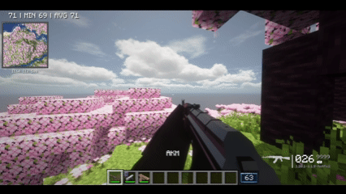
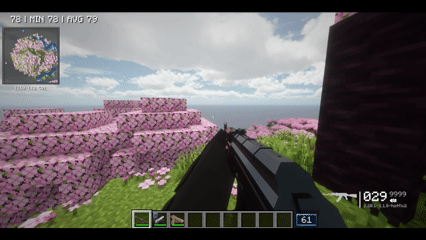

# TaCZ Ad Astra Arm Fix (Unofficial Patch)

With an **Ad Astra space suit, netherite space suit or jet suit chestplate** on, your first-person arms go wrong while holding a **TaCZ** gun. They <strong>stretch, point off into the distance</strong> and get worse as you aim, reload and run. This small companion mod draws your **normal arms** in first person instead, exactly as without a suit, so <strong>TaCZ guns are held properly</strong>.

The stretching happens when [playerAnimator](https://www.curseforge.com/minecraft/mc-mods/playeranimator) is installed, which TaCZ uses for its third-person animations. Without it, the suit arm is only slightly out of place, and the mod fixes that too.

***

## Supported Versions

Pick the file that matches your **Minecraft version and loader**.

<table>
  <tr>
    <th align="left">Requirement</th>
    <th align="left">Forge 1.20.1</th>
    <th align="left">NeoForge 1.21.1</th>
    <th align="left">Fabric 1.21.1</th>
  </tr>
  <tr>
    <td><strong>Mod version</strong></td>
    <td>1.0.0</td>
    <td>1.0.0</td>
    <td>1.0.0</td>
  </tr>
  <tr>
    <td><strong>Minecraft</strong></td>
    <td>1.20.1</td>
    <td>1.21.1</td>
    <td>1.21.1</td>
  </tr>
  <tr>
    <td><strong>Loader</strong></td>
    <td>Forge 47 or newer</td>
    <td>NeoForge 21.1</td>
    <td>Fabric Loader 0.15 or newer</td>
  </tr>
  <tr>
    <td><strong>Ad Astra</strong></td>
    <td>1.15.21 or newer</td>
    <td>1.16.26 or newer</td>
    <td>1.16.26 or newer</td>
  </tr>
  <tr>
    <td><strong>TaCZ</strong> <em>(tested)</em></td>
    <td><a href="https://www.curseforge.com/minecraft/mc-mods/timeless-and-classics-zero">TaCZ</a> 1.1.8-hotfix2</td>
    <td><a href="https://www.curseforge.com/minecraft/mc-mods/tacz-1-21-1">[UNOFFICIAL] TaCZ NeoForge Port</a> 1.1.8-hotfix-r7</td>
    <td><a href="https://www.curseforge.com/minecraft/mc-mods/tacz-refabricated">TaCZ: Refabricated</a> 0.7.1</td>
  </tr>
  <tr>
    <td><strong>Sides</strong></td>
    <td><strong>Client only</strong></td>
    <td><strong>Client only</strong></td>
    <td><strong>Client only</strong></td>
  </tr>
</table>

<strong>NOTE</strong>: There is <strong>no Forge jar for 1.21.1</strong>, because neither Ad Astra nor any TaCZ port exists for Forge on 1.21.1.

***

## Preview

<table>
  <tr>
    <td align="center"></td>
    <td align="center"></td>
  </tr>
  <tr>
    <td align="center"><strong>Without the mod</strong></td>
    <td align="center"><strong>With the mod</strong></td>
  </tr>
</table>

<em>Both clips play at double speed to keep the GIFs short. They were filmed on Minecraft 1.20.1. The 1.21.1 versions look the same.</em>

***

## Credit

This is an **unofficial patch**, not affiliated with Ad Astra or TaCZ. [Ad Astra](https://www.curseforge.com/minecraft/mc-mods/ad-astra) is made by Terrarium (Alex Nijjar and contributors). [TaCZ (Timeless and Classics Zero)](https://www.curseforge.com/minecraft/mc-mods/timeless-and-classics-zero) is made by the TaCZ team. On 1.21.1 it comes from two unofficial ports: the [NeoForge port](https://www.curseforge.com/minecraft/mc-mods/tacz-1-21-1) by MUKSC and [TaCZ: Refabricated](https://www.curseforge.com/minecraft/mc-mods/tacz-refabricated) by Sh1roCu.
